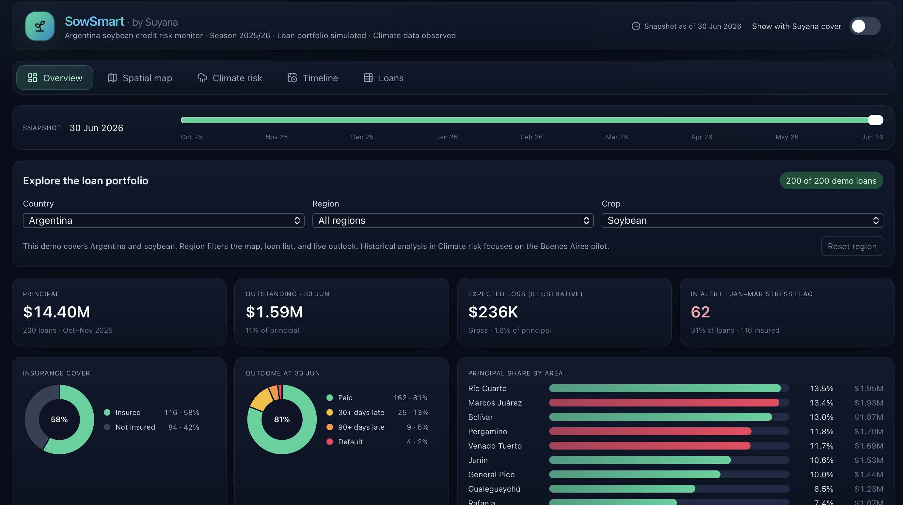

<h1 align="center">🌱 SowSmart</h1>

<strong>Climate-risk monitoring for agricultural lenders</strong>

[Dashboard source](https://sowsmart-radar.vercel.app) 

---

SowSmart is a climate-risk dashboard for agricultural lenders, built for the **Suyana Climate Insurance challenge** at the **2026 MIT Energy & Climate Hack**. It helps a loan officer identify soybean loans that may warrant a grower check-in, see which climate signals explain the concern, and ask about crop stage, field conditions and irrigation access.

## 👥 Team and challenge

- **Contributors** — [Ansha Pathak](https://www.linkedin.com/in/anshapathak11/), [Katherine Book](https://www.linkedin.com/in/katherine-book-4a19b3106/), [Janhavi Beley](https://www.linkedin.com/in/janhavibeley/) and [Nikki Safarova](https://www.linkedin.com/in/nssafarova/).
- **Challenge sponsor** — [Suyana Climate Insurance](https://suyana.io/).
- **Suyana challenge representatives** — [Fernando Yu](https://www.linkedin.com/in/fernandoyu/) and Justin Muñoz.
- **Event** — [MIT Energy & Climate Hack 2026](https://www.mitenergyhack.org/).

Credits follow the team’s challenge plan and pitch deck.

## 🗺️ What we built

  

| View | What you can do |
| --- | --- |
| **Portfolio and maps** | Explore **200 simulated soybean loans** across five Argentine provinces. Filter by region and select a loan to inspect its details. |
| **Live climate outlook** | Retrieve modelled temperature and soil moisture, where available, and a seven-day forecast of daily highs and rainfall. |
| **Historical analysis** | Compare heat, rainfall and root-zone soil wetness in **2022/23** and **2024/25** at a Buenos Aires pilot. |
| **Lender follow-up** | See an early-contact step for current loans with an active alert and a separate prevention step for qualifying uninsured loans. |

## ▶️ Demo walkthrough

1. Open `index.html` in a browser with internet access. The non-commercial demo requires no installation, build step or API key.
2. Filter to **Buenos Aires**, then select a loan in **Spatial map** or **Loans**.
3. In **Climate risk**, click **Get latest forecast**. Review forecast highs, rainfall and days at or above **35 °C**.
4. Scroll to **Argentina soybean climate analysis** to compare the seasons and inspect the monthly values.

<!-- Optional image: add a screenshot of the selected loan’s forecast.

-->

## 📊 Results

At the Buenos Aires pilot, **2022/23 had more hot days and less January–March rainfall than 2024/25**. The charts in **Climate risk** show when the seasons diverged.

We checked the chart calculations against the supplied data. Forecast accuracy, warning lead time and repayment impact were not validated.

<!-- Optional image: add a snapshot of the seasonal comparison.

-->

## 🔎 Data and limitations

| Data | Source and scope |
| --- | --- |
| **Current weather and forecast** | Modelled conditions at the selected loan coordinates. The outlook shows the valid time and retrieval time. [Open-Meteo](https://open-meteo.com/en/docs) |
| **Historical temperature and rainfall** | Daily values embedded in the original Radar for **34.06°S, 61.20°W**. The saved page does not identify the upstream dataset. [Original SowSmart Radar](https://sowsmart-radar.vercel.app) |
| **Historical soil wetness** | Team-supplied MERRA‑2 `GWETROOT` exports for the nearest grid cell. The series uses a **0–1 wetness index** and has no April 2023 coverage. [NASA POWER](https://power.larc.nasa.gov/docs/services/api/temporal/daily/) |
| **Loan and repayment figures** | Simulated portfolio records and illustrative loss estimates. |

The historical analysis describes **one pilot location**. The **35 °C** cutoff is an illustrative screening threshold.
